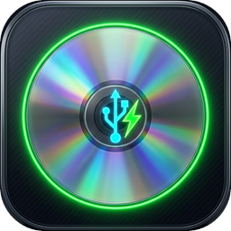

# ⚡ DrivePro 360 - Official Releases & Downloads

  
  <h3>Xbox 360 DVD Drive Firmware Utility & X360USB Pro Flasher</h3>
  
<b>A modern, high-performance 64-bit utility for dumping, spoofing, unlocking, and flashing Xbox 360 optical drives.</b>

  

    
    
    
  

---

## 📥 ดาวน์โหลดเวอร์ชันล่าสุด (Downloads - v1.0.0)

| Package | รายละเอียด / Description | ขนาด / Size | ดาวน์โหลด / Download Link |
| :--- | :--- | :---: | :---: |
| **DrivePro 360 Standalone (แนะนำ)** | รวม .NET 8 ในตัว พร้อมเปิดใช้งานทันที ไม่ต้องลง Runtime เพิ่ม | ~86 MB | [⬇️ DrivePro360_v1.0.0_Standalone.zip](https://github.com/nikonboy2532-stack/DrivePro-360-Releases/releases/download/v1.0.0/DrivePro360_v1.0.0_Standalone.zip) |
| **DrivePro 360 Portable** | ตัวเบา สำหรับเครื่องที่มี .NET 8.0 Desktop Runtime แล้ว | ~20 MB | [⬇️ DrivePro360_v1.0.0_Portable.zip](https://github.com/nikonboy2532-stack/DrivePro-360-Releases/releases/download/v1.0.0/DrivePro360_v1.0.0_Portable.zip) |

### 🔐 ค่าความปลอดภัยตรวจสอบไฟล์ (SHA256 Checksums)
- `DrivePro360_v1.0.0_Standalone.zip`:  
  `BF2DB233B8B32C26221DEC82E0664EE9631BD7B7853B0ED61BAEF262E42E34D9`
- `DrivePro360_v1.0.0_Portable.zip`:  
  `E92C1CE71E14AE237023B173D261C0A2B6C9192D30C026AC5B32D1B4F3D2DC2C`

---

## ✨ ฟังก์ชันและความสามารถเด่น (Key Features)

- **🚀 สถาปัตยกรรม USB Direct 100%**:
  ติดต่อกับฮาร์ดแวร์ **X360USB Pro v1 และ v2** โดยตรงผ่าน Native USB Endpoints (`0x01` OUT / `0x81` IN) กำจัดไดรเวอร์โบราณ PortIO32/64 และ DLPortIO ใช้งานได้ทันทีบน Windows 10 และ 11 64-bit ทุกรุ่น
- **🔑 ดึงคีย์และดัมพ์รอมครบทุกรุ่น (DVDKey 32)**:
  - **SlimKey**: รองรับ Lite-On DG-16D4S (0225, 0401, 1071, 0272, 9504) ผ่าน USB Challenge-Response 16 ขั้นตอน พร้อมดึง 4KB Key Sector สมบูรณ์
  - **PhatKey**: รองรับ Lite-On DG-16D2S (74850C, 83850C, 93450C, 02510C) ด้วยเข็มเจาะ Probe 3 / MPX01
  - **BenQ / Samsung**: ปลดล็อค Vendor Mode 0x73 / 0x70 อัตโนมัติ
- **💾 แฟลชรอม MTK เต็มรูปแบบ (MTK Flash 32)**:
  - อ่าน (Read) และเขียน (Write) 4 แบงก์ครบ 256 KB
  - คำสั่ง Erase ชิป และคำสั่ง Spi Lock / Unlock
- **⏏️ Drive Tray Tools**: ควบคุมถาดไดรฟ์ Eject, Close, และ Half-Open จากโปรแกรม
- **📁 Customer Key Vault**: จัดเก็บสำรองชุดคีย์ลูกค้า แยกตามรุ่นไดรฟ์และวันที่พร้อมไฟล์สรุปอัตโนมัติ
- **🎛️ Laser Pot Calibrator**: ระบบคำนวณและวัดค่าความต้านทานโอห์มหัวอ่านเลเซอร์ (HOP-141X, HOP-15XX)
- **⚡ Kamikaze Drill Live Monitor**: ตรวจสอบสถานะ SPI Register 0x8C -> 0x00 ขณะเจาะชิปแบบเรียลไทม์พร้อมเสียงไซเรนเตือน
- **📦 Embedded CFW Library**: รวมรอม Stock และ LT-Plus 3.0 ครบ 110 ไฟล์ ออโต้โหลดและสปูฟให้อัตโนมัติ
- **🔄 Auto-Updater**: ระบบตรวจสอบเวอร์ชันใหม่ผ่าน GitHub Releases โดยตรง

---

## 💖 สนับสนุนผู้พัฒนา (Support & Donations)

โปรแกรม DrivePro 360 จัดทำและเผยแพร่ฟรีเพื่อการศึกษาและการซ่อมแซมบำรุงรักษาฮาร์ดแวร์ หากโปรแกรมนี้ช่วยประหยัดเวลาและช่วยเหลืองานของท่าน สามารถสนับสนุนทีมงานได้ที่:

- 🇹🇭 **พร้อมเพย์ (PromptPay)**: `084-242-6325` (นาย นิกร อ่อนจันทร์)
- 🌐 **PayPal (International)**: [paypal.me/nikonboy](https://www.paypal.me/nikonboy)

---

## 📋 ข้อกำหนดของระบบ (System Requirements)
- **ระบบปฏิบัติการ**: Windows 10 หรือ Windows 11 (64-bit เท่านั้น)
- **ฮาร์ดแวร์**: X360USB Pro v1 หรือ v2 (ติดตั้งไดรเวอร์ libusb-win32 หรือ WinUSB)
- **สายเชื่อมต่อ**: สาย USB คุณภาพดี และสาย SATA ระหว่าง X360USB Pro กับไดรฟ์ DVD

---

© 2026 P.D. PROVIDE CO., LTD. / พัฒนาโดย บริษัท พี.ดี. โปรไวด์ จำกัด
